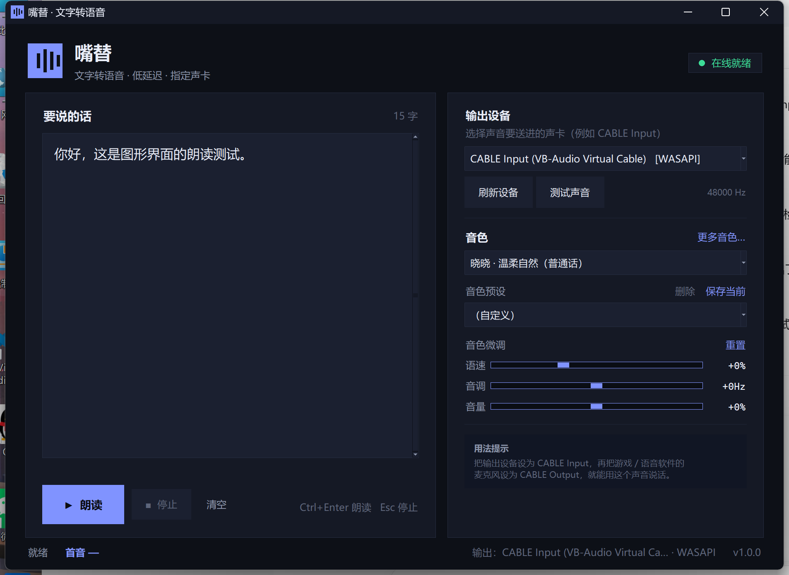

# 嘴替 · MouthSubstitute

一个给 Windows 用的**低延迟文字转语音（TTS）小工具**：输入文字，选择音色，把声音直接送进指定声卡（例如 VB-Audio Virtual Cable），在游戏、语音软件或直播里当“嘴替”。

界面用 Python + Tkinter 编写，不依赖 ffmpeg、不下载语音模型，装完依赖即可运行，整个程序目录拷走就能用。



---

## 功能

| 需求 | 实现 |
| --- | --- |
| 1. 文字转语音 | 微软 Edge 在线语音（322 个音色，中文 14 个），24 kHz / 48 kbps MP3，流式合成 |
| 2. 输出到指定设备 | 枚举所有 WASAPI / MME / DirectSound 输出设备，按名称选择；声音直接写入目标声卡，不经过系统默认设备 |
| 3. 自定义音色 | 中文音色库 + 音调 / 语速 / 音量微调 + 自定义音色 ID + 可保存 / 删除的音色预设 |
| 4. 低延迟 | 启动即预热 WebSocket 长连接；音频边收边解码边播放；60 ms 起播缓冲；实测热连接首音约 **0.2–0.5 秒** |
| 5. 图形界面 | 深色 Tkinter 界面，左侧输入、右侧调音色和设备，支持 `Ctrl+Enter` 朗读、`Esc` 停止 |
| 6. 轻量 / 可移植 | 无模型、无 ffmpeg、无数据库；配置和缓存都在程序目录 `data/`；依赖约 30–50 MB；不写注册表 |

另外支持：

- 常用音色预设（晓晓、晓伊、云希、云健、云夏、云扬、东北话、粤语、台湾腔）
- “更多音色”对话框：搜索、按语言筛选、直接填音色 ID
- 设备测试音、设备刷新、掉线自动重连
- 长文本按句子自动切段、顺序合成
- 命令行自测 / 设备与音色列表

---

## 快速开始

### 1. 安装 Python

需要 **Python 3.10 或更高版本**（推荐 3.12 / 3.13），安装时勾选 **Add python.exe to PATH**。

下载：<https://www.python.org/downloads/windows/>

### 2. 安装依赖

双击 `install.bat`，它会在当前目录创建 `.venv` 并安装：

- `edge-tts`（协议、DRM 签名、音色列表）
- `miniaudio`（MP3 解码）
- `sounddevice`（PortAudio / WASAPI 输出）

首次安装需要联网，约 30–50 MB。

> 如果 PyPI 访问慢：先执行 `set PIP_INDEX_URL=https://pypi.tuna.tsinghua.edu.cn/simple`，再运行 `install.bat`。

### 3. 启动

双击 `run.bat`（无控制台窗口）。

调试时用 `run_console.bat`，或在 PowerShell 里：

```powershell
.\.venv\Scripts\python.exe app.py
```

---

## 界面说明

```
┌──────────────────────────────────────────────┬─────────────────────┐
│ 要说的话                             12 字   │ 输出设备            │
│ ┌──────────────────────────────────────────┐ │ [CABLE Input ...]   │
│ │ 在这里输入想说的话……                     │ │ 刷新设备  测试声音  │
│ │                                          │ │                     │
│ └──────────────────────────────────────────┘ │ 音色                │
│ ▶ 朗读   ■ 停止   清空   Ctrl+Enter / Esc    │ [晓晓 · 温柔自然]   │
│                                              │ 音色预设 [自定义]   │
│                                              │ 语速 ─────── +0%    │
│                                              │ 音调 ─────── +0Hz   │
│                                              │ 音量 ─────── +0%    │
└──────────────────────────────────────────────┴─────────────────────┘
 就绪   首音 320 ms                    输出：CABLE Input · WASAPI
```

- **朗读**：把文字合成到所选设备。合成期间按钮会变灰，**停止**可立即打断（实测 1 ms 内静音）。
- **输出设备**：选择声音进入哪张声卡。改完可以点“测试声音”确认。
- **音色**：下拉是中文音色；“更多音色…”可以搜索全部 322 个音色，或直接填音色 ID。
- **音色预设**：选一个预设会同时设置音色、音调和语速；“保存当前”可把自己的组合存下来。
- **音色微调**：语速 −50%～+100%，音调 −50～+50 Hz，音量 −50%～+50%。改动后预设自动变成“（自定义）”。

配置会自动保存到 `data/config.json`，下次打开恢复上次的文本、音色、设备和窗口位置。

---

## 把声音送进游戏 / 语音软件

这是本工具最典型的用法。以 **VB-Audio Virtual Cable** 为例（免费版即可）：

1. 安装 VB-CABLE 后，系统里会出现两个设备：
   - `CABLE Input (VB-Audio Virtual Cable)`：播放设备
   - `CABLE Output (VB-Audio Virtual Cable)`：录音设备
2. 在“嘴替”的 **输出设备** 里选择 `CABLE Input`。
3. 在游戏 / Discord / 微信 / OBS 里，把**麦克风**选成 `CABLE Output`。
4. 点“朗读”，你的声音就会从虚拟麦克风进入对方耳中。

如果自己也想听到，可以在 Windows 声音设置里打开 `CABLE Output` 的“侦听”，或者用 VB-CABLE 的 `Listen` 功能。

> 没有虚拟声卡也可以直接用：输出设备选扬声器 / 耳机即可，只是声音不会进入麦克风。

---

## 延迟说明

| 场景 | 首音延迟（本机实测） |
| --- | --- |
| 程序刚启动、连接尚未完成 | 约 1.0–1.3 秒（等 TLS/WebSocket 握手） |
| 连接已预热（正常使用） | 约 **0.2–0.4 秒** |
| 停止播放 | < 10 ms |
| 停止后立刻再读 | 约 0.3 秒（后台自动重连） |

实现方式：

- 启动时在后台完成 `wss://speech.platform.bing.com` 的 TLS + WebSocket 握手，并每 20 秒 ping 保活；
- 朗读时只发 SSML，不等连接建立；
- Edge 的 MP3 分片一到就推进 `LiveSink`，`miniaudio` 增量解码；
- 攒够 60 ms PCM 就开始写 PortAudio，之后边解码边播放；
- 使用 WASAPI 共享模式 + `latency="low"`，10 ms 一块。

60 ms 是“首音延迟”和“网络抖动不爆音”之间的折中。网络较差时可以改 `data/config.json` 里的 `prebuffer_ms`（0–300）。

---

## 自定义音色

Edge 共 322 个音色，中文 14 个。除了直接选，还可以：

1. **微调**：同一音色 + 不同音调 / 语速，能得到明显不同的“人设”（例如晓晓 −20 Hz 更温柔，+15% 更活泼）。
2. **预设**：调好后点“保存当前”，起个名字；之后一键切换。预设支持删除（内置预设不可删）。
3. **自定义 ID**：在“更多音色”底部直接输入任意音色 ID（例如 `zh-CN-XiaoyiNeural`、`en-US-AvaMultilingualNeural`），保存后即可使用。
4. **手改配置**：`data/config.json` 的 `presets` 数组可以直接加条目：

   ```json
   {
     "name": "我的电台音",
     "voice": "zh-CN-YunyangNeural",
     "rate": -5,
     "pitch": -8,
     "volume": 0
   }
   ```

> 音高（pitch）靠服务端做移调，±50 Hz 以内比较自然，拉满会有明显的“电子味”。

---

## 命令行

```powershell
# 看所有输出设备
.\.venv\Scripts\python.exe app.py --list-devices

# 看音色（缓存 / 内置中文）
.\.venv\Scripts\python.exe app.py --list-voices

# 无界面合成自测：真的会往指定设备播放
.\.venv\Scripts\python.exe app.py --selftest --device "CABLE Input" --text "你好，这是自测。"

# 指定音色和语调
.\.venv\Scripts\python.exe app.py --selftest --device "扬声器" --voice zh-CN-YunxiNeural --rate 5 --pitch 3
```

`--selftest` 会打印“首包”“首音”和播放完成时间，方便排查延迟。

---

## 常见问题

**没有声音 / 选错设备**

- 点“刷新设备”，选对输出设备，再点“测试声音”。
- 如果选了 `CABLE Input`，声音不会从扬声器出来，这是正常的——它进了虚拟麦克风。
- 检查 Windows 音量合成器里 Python 是否被静音。
- 用 `run_console.bat` 启动，看控制台和 `data/logs/app.log` 的报错。

**“连接中…”一直不消失 / 显示离线**

- 程序需要访问 `speech.platform.bing.com:443`。
- 公司网络 / 代理：先设置 `HTTPS_PROXY` 环境变量再启动，例如
  `set HTTPS_PROXY=http://127.0.0.1:7890`。
- 校准系统时间（Edge 的签名和时钟有关；时间偏差过大会被 403 拒绝）。
- 服务偶发不可用时，等几秒会自动重连。

**提示设备被占用**

- WASAPI 独占模式的应用会占住声卡。关掉独占，或换一个设备（MME / DirectSound 备用项）。

**首次点“朗读”要等 1 秒多**

- 属于冷启动：程序正在建立长连接。等右上角变成“在线就绪”后再读，首音就是 0.2–0.4 秒。

**杀毒软件误报**

- 程序只做网络请求和音频播放，不写注册表、不装服务。可以给程序目录加信任。

**在 PowerShell 里 `pip install` 报 `No matching distribution`，或装到了错误的 Python**

先运行：

```powershell
where pip
```

如果输出是 `D:\python\Scripts\pip.exe`（而不是 `.venv\Scripts\pip.exe`），说明你用的是**全局 pip**。当前目录在 `.venv\Scripts` 并不会让 PowerShell 优先使用它；直接敲 `pip` 仍然走 PATH。

正确做法（在项目根目录执行）：

```powershell
.\.venv\Scripts\python.exe -m pip install pyinstaller
```

或者先激活虚拟环境，再始终用 `python -m pip`：

```powershell
.\.venv\Scripts\Activate.ps1
python -m pip install pyinstaller
```

全局 pip 的清华源在这台机器上不可用；如果确实需要全局 pip，可以改源，但**不要把项目依赖装进全局 Python**：

```powershell
pip config set global.index-url https://pypi.org/simple
```

**PyCharm 里更新 / 安装依赖失败，提示 `No module named pip`**

通常是 `.venv` 里的 pip 被中断的 pip 自升级弄坏了：pip 目录被改名成 `~ip`，新版本没有装回来。PyCharm 的依赖安装工具会执行 `import pip`，所以所有安装/更新都会失败。

修复（在本项目目录打开 PowerShell）：

```powershell
# 方法一：把残留的 ~ip 改回 pip
Rename-Item .venv\Lib\site-packages\~ip pip
Rename-Item .venv\Lib\site-packages\~ip-25.0.1.dist-info pip-25.0.1.dist-info

# 方法二：如果上面目录不存在，直接重装 pip
.\.venv\Scripts\python.exe -m ensurepip --upgrade
```

然后确认：

```powershell
.\.venv\Scripts\python.exe -m pip --version
.\.venv\Scripts\python.exe -m pip install -r requirements.txt
```

如果 PyCharm 仍显示旧错误，执行 **File → Invalidate Caches / Restart**，或重新打开 Python Packages 面板。

如果日志里出现 `No usable temporary directory found`，说明 PyCharm 的 Python 子进程拿不到可写的临时目录。先确认 `%TEMP%` 存在且可写；不行就新建 `C:\Temp`，把用户环境变量 `TEMP`、`TMP` 指到它，完全退出并重启 PyCharm。

另外，这台机器上的全局 pip 源（清华镜像）当前返回 403，所以 `install.bat` 现在默认使用 `https://pypi.org/simple`，并在 `.venv\pip.ini` 里固定该源。PyCharm 会用这个配置。想换回国内镜像时：

```powershell
set PIP_INDEX_URL=https://pypi.tuna.tsinghua.edu.cn/simple
install.bat
```

**尽量不要在镜像不可用时点 PyCharm 的“升级 pip”**；pip 升级会先把旧 pip 改名再替换，失败就会留下 `~ip`。

**音色列表是旧的 / 打不开**

- “更多音色”里点“刷新在线列表”；断网时会退回内置的 14 个中文音色。

---

## 技术结构

```
app.py                 入口：日志、DPI、命令行、启动界面
mouthtts/
  config.py            配置 / 音色缓存读写（data/）
  textutil.py          文本清洗、分句、长文本切段
  voices.py            中文音色目录、音色列表缓存、内置预设
  audio.py             输出设备枚举、WASAPI 低延迟流、测试音
  edge_engine.py       常热 Edge WebSocket 客户端、重连、保活
  pipeline.py          LiveSink、MP3 增量解码、播放线程、状态机
  ui.py                Tkinter 界面、音色库对话框
tests/                 29 个单元测试
data/config.json       自动生成：设置、预设、窗口位置
data/voices.json       自动生成：在线音色缓存
data/logs/app.log      自动生成：滚动日志
```

关键设计：

- **不复用 `edge_tts.Communicate` 的每次新建连接**，而是借用它的协议常量和 DRM 签名，自己维护一条常热连接，省掉约 0.7 秒握手。
- **MP3 增量解码**：`miniaudio.stream_any` 从 `LiveSink` 拉数据，半个 MP3 帧也能先出 PCM；不是“整句合成完再播”。
- **三段式线程**：Tkinter 主线程 / asyncio 网络线程 / 播放线程，彼此只通过队列和 `LiveSink` 通信，界面不卡。
- **设备选择**：PortAudio 设备索引会随插拔变化，所以配置里保存 `hostapi + 设备名`，启动时按名字重新匹配，找不到再退回系统默认。

依赖版本固定（`requirements.txt`）：

```
edge-tts==7.3.1
miniaudio==1.71
sounddevice==0.5.6
```

`edge_tts` 的协议实现升级时可能改动常量或签名算法。如果某天突然全部 403/1011，优先尝试升级 `edge-tts` 并同步调整 `edge_engine.py`。

---

## 可移植性

- 纯 Python，无 C 编译、无模型下载、无 ffmpeg。
- `sounddevice` 和 `miniaudio` 的 wheel 自带 PortAudio / MP3 解码库。
- 所有状态都在程序目录 `data/`，不写注册表、不写用户目录；如果程序目录不可写（例如放在 `Program Files`），配置会自动退回到 `%LOCALAPPDATA%\MouthSubstitute`。
- 换电脑：拷贝源码目录（不必带 `.venv`）→ 在新机器装 Python → 运行 `install.bat`。
- 也可以自行用 PyInstaller 打包（PyInstaller 不是运行依赖，只打包时需要）：
  ```powershell
  .\.venv\Scripts\python.exe -m pip install pyinstaller
  .\.venv\Scripts\python.exe -m PyInstaller --noconsole --onedir --name MouthSubstitute app.py
  ```
  注意把 `data/` 放在 exe 同级的可写目录。PyInstaller 会生成 `build/`（中间缓存，可删）和 `dist/`（最终程序）；`build` 里的 exe 不是成品，分发时要整个 `dist\MouthSubstitute\` 文件夹一起带走，或改用 `--onefile`。

---

## 已知限制

- **需要联网**：本版本使用微软 Edge 在线语音，断网时无法合成；没有打包本地 TTS 模型或 Windows SAPI，这是为了保持“轻量、可移植”。
- 依赖 Edge 语音服务的协议；服务策略变化时可能失效。`requirements.txt` 固定了 `edge-tts==7.3.1`，服务升级时可尝试更新该依赖并同步 `edge_engine.py`。
- 输出为 24 kHz 单声道 MP3，适合人声、游戏语音和直播，不适合音乐制作。
- 目前只针对 Windows（WASAPI / MME / DirectSound）测试，macOS / Linux 未验证。
- 音色是“选择 + 音调 / 语速 / 音量”的自定义，不是声音克隆；克隆需要本地大模型，和轻量化目标冲突。

---

## 隐私与使用条款

- 文字会发送到微软 Edge 的在线语音服务进行合成；程序本身不收集、不上传其他数据。
- 语音缓存只存在于内存，不落盘（除非你自己保存音频）。
- 请遵守微软服务条款，仅用于个人学习、辅助交流等合法用途；不要用于冒充他人、诈骗或骚扰。

---

## 第三方组件

| 组件 | 用途 | 许可证 |
| --- | --- | --- |
| [edge-tts](https://github.com/rany2/edge-tts) | Edge 语音协议、DRM 签名、音色列表 | LGPLv3（`srt_composer.py` 为 MIT） |
| [miniaudio](https://github.com/irmen/pyminiaudio) | MP3 解码、重采样 | MIT |
| [sounddevice](https://github.com/spatialaudio/python-sounddevice) | PortAudio / WASAPI 输出 | MIT |

本项目自身代码使用 MIT 许可证，见 `LICENSE`。

---

## 开发 / 测试

```powershell
# 单元测试
.\.venv\Scripts\python.exe -m unittest discover -s tests -v

# 真实链路自测（会出声，注意音量）
.\.venv\Scripts\python.exe app.py --selftest --device "CABLE Input"
```

测试覆盖：文本清洗与切段、配置归一化 / 损坏恢复、音色目录与预设、`LiveSink` 队列语义。

---

**版本**：1.0.0  
**测试环境**：Windows 11 26200 / Python 3.13.3 / VB-Audio Virtual Cable / Realtek
